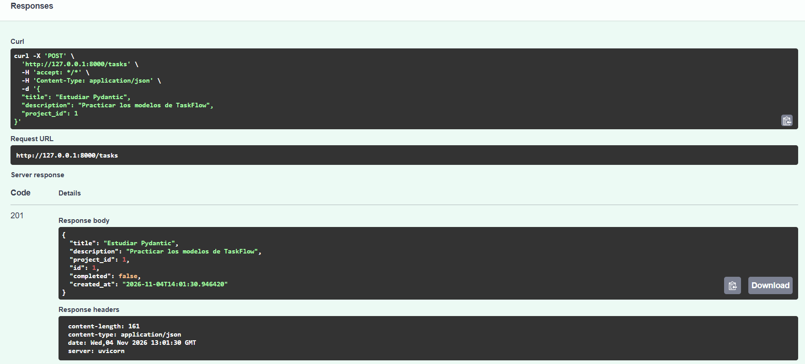

# Práctica 1.1 — Primeros endpoints y estructura inicial

## Objetivo

Crear una API inicial con FastAPI, configurar el entorno virtual y comprobar que los endpoints funcionan correctamente.

## Desarrollo

Se ha creado un entorno virtual de Python y se han instalado FastAPI y Uvicorn. El proyecto está organizado en la carpeta `app`, que contiene `__init__.py` y `main.py`.

También se ha creado `requirements.txt` para indicar las dependencias y `.gitignore` para excluir archivos innecesarios.

## Endpoints implementados

- **GET /health:** devuelve `{"status": "ok"}`.
- **GET /version:** devuelve la versión `1.0.0`.
- **GET /ping:** devuelve `{"message": "pong"}`.

Los tres endpoints incluyen `summary`, `description` y `response_model`.

## Comprobaciones

El servidor se ha iniciado con Uvicorn y se ha comprobado la documentación automática en `/docs`. Los tres endpoints se han probado desde Swagger y han respondido correctamente.

## Captura de pantalla

Se incluye una captura de la documentación Swagger donde aparecen los tres endpoints implementados.

## Conclusión

La práctica ha servido para crear la estructura inicial de una API con FastAPI, configurar las dependencias y comprobar los endpoints y la documentación automática.

# Práctica 1.2 — Modelado con Pydantic

## Objetivo

En esta práctica hemos trabajado con Pydantic para crear los modelos de entrada y salida de la API TaskFlow.

El objetivo es validar los datos que recibe la API y definir qué información devuelve.

## Archivos creados y modificados

- `app/schemas.py`: contiene los modelos de Pydantic.
- `app/main.py`: contiene los endpoints de la API y el nuevo endpoint para crear tareas.

## Modelos creados

En `schemas.py` se han creado cuatro modelos:

- **TaskCreate:** contiene el título, la descripción y el identificador del proyecto.
- **TaskRead:** contiene los datos de TaskCreate y añade el identificador de la tarea, si está completada y la fecha de creación.
- **ProjectCreate:** contiene el nombre y la descripción del proyecto.
- **ProjectRead:** contiene los datos de ProjectCreate y añade el identificador y la fecha de creación.

## Validación de datos

Se ha utilizado `Field` para validar el campo `title` de TaskCreate.

```python
title: str = Field(min_length=1, max_length=100)
```

El título debe tener como mínimo un carácter y como máximo 100.

Si se envía un título vacío, FastAPI devuelve un error 422.

## Endpoint añadido

Se ha creado el endpoint temporal:

`POST /tasks`

Este endpoint recibe los datos mediante TaskCreate y devuelve una respuesta utilizando TaskRead.

La respuesta incluye:

- ID de la tarea.
- Título.
- Descripción.
- ID del proyecto.
- Estado de la tarea.
- Fecha de creación.

El endpoint devuelve el código HTTP 201 cuando la petición es correcta.

Los datos son simulados y todavía no se guardan en una base de datos.

## Pruebas realizadas

Las pruebas se han realizado desde Swagger:

`http://127.0.0.1:8000/docs`

### 1. Prueba válida (201)

Se ha enviado una tarea con los datos correctos y la API ha devuelto el código 201.



### 2. Prueba inválida (422)

Se ha enviado una tarea con el título vacío y la API ha devuelto el error 422 por incumplir la validación.


