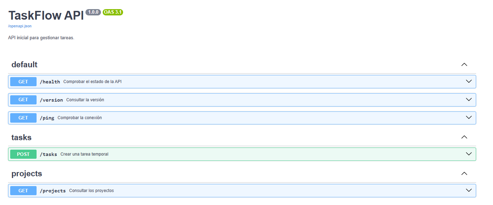
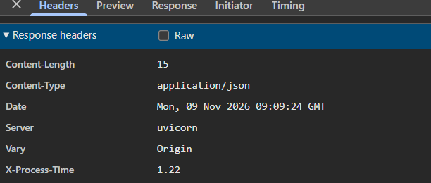
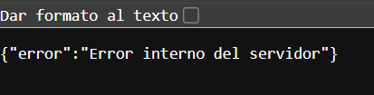

# Práctica 1.1 — Primeros endpoints y estructura inicial

## Objetivo

Crear una API inicial con FastAPI, configurar el entorno virtual y comprobar que los endpoints funcionan correctamente.

## Desarrollo

Se ha creado un entorno virtual de Python y se han instalado FastAPI y Uvicorn. El proyecto está organizado en la carpeta `app`, que contiene `__init__.py` y `main.py`.

También se ha creado `requirements.txt` para indicar las dependencias y `.gitignore` para excluir archivos innecesarios.

## Endpoints implementados

- **GET /health:** devuelve `{"status": "ok"}`.
- **GET /version:** devuelve la versión `1.0.0`.
- **GET /ping:** devuelve `{"message": "pong"}`.

Los tres endpoints incluyen `summary`, `description` y `response_model`.

## Comprobaciones

El servidor se ha iniciado con Uvicorn y se ha comprobado la documentación automática en `/docs`. Los tres endpoints se han probado desde Swagger y han respondido correctamente.

## Captura de pantalla

Se incluye una captura de la documentación Swagger donde aparecen los tres endpoints implementados.

## Conclusión

La práctica ha servido para crear la estructura inicial de una API con FastAPI, configurar las dependencias y comprobar los endpoints y la documentación automática.

# Práctica 1.2 — Modelado con Pydantic

## Objetivo

En esta práctica hemos trabajado con Pydantic para crear los modelos de entrada y salida de la API TaskFlow.

El objetivo es validar los datos que recibe la API y definir qué información devuelve.

## Archivos creados y modificados

- `app/schemas.py`: contiene los modelos de Pydantic.
- `app/main.py`: contiene los endpoints de la API y el nuevo endpoint para crear tareas.

## Modelos creados

En `schemas.py` se han creado cuatro modelos:

- **TaskCreate:** contiene el título, la descripción y el identificador del proyecto.
- **TaskRead:** contiene los datos de TaskCreate y añade el identificador de la tarea, si está completada y la fecha de creación.
- **ProjectCreate:** contiene el nombre y la descripción del proyecto.
- **ProjectRead:** contiene los datos de ProjectCreate y añade el identificador y la fecha de creación.

## Validación de datos

Se ha utilizado `Field` para validar el campo `title` de TaskCreate.

```python
title: str = Field(min_length=1, max_length=100)
```

El título debe tener como mínimo un carácter y como máximo 100.

Si se envía un título vacío, FastAPI devuelve un error 422.

## Endpoint añadido

Se ha creado el endpoint temporal:

`POST /tasks`

Este endpoint recibe los datos mediante TaskCreate y devuelve una respuesta utilizando TaskRead.

La respuesta incluye:

- ID de la tarea.
- Título.
- Descripción.
- ID del proyecto.
- Estado de la tarea.
- Fecha de creación.

El endpoint devuelve el código HTTP 201 cuando la petición es correcta.

Los datos son simulados y todavía no se guardan en una base de datos.

## Pruebas realizadas

Las pruebas se han realizado desde Swagger:

`http://127.0.0.1:8000/docs`

### 1. Prueba válida (201)

Se ha enviado una tarea con los datos correctos y la API ha devuelto el código 201.


### 2. Prueba inválida (422)

Se ha enviado una tarea con el título vacío y la API ha devuelto el error 422 por incumplir la validación.


# Práctica 1.3 — Organización con APIRouter

## 1. Objetivo

El objetivo de esta práctica es organizar las rutas de TaskFlow API utilizando `APIRouter`, separando los endpoints según el recurso al que pertenecen.

De esta forma, el archivo `main.py` queda más limpio y cada grupo de rutas está organizado en su propio archivo.

## 2. Estructura del proyecto

Se ha creado la carpeta `routers` dentro de `app` para separar las rutas.

La estructura utilizada es:

```text
app/
│
├── main.py
├── schemas.py
├── __init__.py
│
└── routers/
    ├── __init__.py
    ├── tasks.py
    └── projects.py
```

## 3. Cambios realizados

### Router de tareas

Se ha creado el archivo `tasks.py`, utilizando `APIRouter` con:

- Prefix: `/tasks`
- Tag: `tasks`

Se ha trasladado el endpoint `POST /tasks` desde `main.py` a este archivo.

### Router de proyectos

Se ha creado el archivo `projects.py`, utilizando `APIRouter` con:

- Prefix: `/projects`
- Tag: `projects`

También se ha añadido el endpoint `GET /projects`, que devuelve una lista vacía.

### Archivo main.py

Se ha modificado `main.py` para importar los routers y registrarlos mediante:

```python
app.include_router(tasks.router)
app.include_router(projects.router)
```

Las rutas generales `/health`, `/version` y `/ping` permanecen en `main.py`.

## 4. Comprobaciones realizadas

Se ha iniciado la aplicación con:

```bash
uvicorn app.main:app --reload
```

Después se ha accedido a Swagger mediante:

http://127.0.0.1:8000/docs

Se ha comprobado lo siguiente:

- Las rutas generales siguen apareciendo en Swagger.
- El endpoint `POST /tasks` aparece dentro del grupo `tasks`.
- El endpoint `GET /projects` aparece dentro del grupo `projects`.
- La petición `GET /projects` devuelve el código HTTP 200 OK.

## 5. Capturas de pantalla

### Captura 1. Swagger con los routers organizados

Se muestra la documentación de Swagger con los grupos `default`, `tasks` y `projects`.



### Captura 2. Comprobación de GET /projects

Se muestra la ejecución del endpoint `GET /projects` y su respuesta HTTP 200 OK.


## 6. Conclusión

Con esta práctica he aprendido a utilizar `APIRouter` para organizar las rutas de una API por recursos.

Separar las rutas en diferentes archivos permite mantener el código más ordenado y facilita su mantenimiento cuando el proyecto va creciendo.

# Práctica 1.4 — Middleware

## 1. Objetivo

El objetivo de esta práctica es añadir funcionalidades que se ejecuten de forma transversal en TaskFlow API mediante middleware.

Se han configurado CORS, un middleware personalizado para medir el tiempo de respuesta y un manejador global de excepciones.

## 2. Configuración de CORS

Se ha configurado `CORSMiddleware` para permitir las peticiones procedentes de:

`http://localhost:5173`

También se han permitido los métodos y cabeceras HTTP y se ha añadido `X-Process-Time` a las cabeceras expuestas para que el frontend pueda consultarla.

## 3. Middleware personalizado

Se ha creado un middleware que mide el tiempo que tarda la API en procesar cada petición.

Para ello se utiliza `time.perf_counter()`, que permite calcular el tiempo transcurrido.

El resultado se añade a la respuesta mediante la cabecera:

`X-Process-Time`

El tiempo se muestra en milisegundos.

## 4. Manejo global de excepciones

Se ha implementado un manejador global para capturar excepciones no controladas.

Cuando se produce un error interno, la API devuelve el código HTTP 500 y un mensaje JSON genérico:

```json
{
    "error": "Error interno del servidor"
}
```

El error completo se registra internamente mediante logging, evitando mostrar información interna o el stacktrace al cliente.

## 5. Pruebas realizadas

Se han realizado las siguientes comprobaciones:

- Petición GET a `/health` para comprobar el funcionamiento de la API.
- Comprobación de la cabecera `X-Process-Time` desde las herramientas de desarrollador.
- Petición a `/error` para comprobar el manejo global de excepciones.
- Petición OPTIONS para comprobar que CORS permite el origen `http://localhost:5173`.

Todas las pruebas han funcionado correctamente.

## 6. Capturas

### Captura 1. Middleware de tiempo

Se muestra la cabecera `X-Process-Time` en la respuesta de la API.



### Captura 2. Manejo global de errores

Se muestra la respuesta JSON con código HTTP 500 al provocar una excepción.



### Captura 3. Configuración CORS

Se muestran las cabeceras que confirman que el origen `http://localhost:5173` está permitido.

